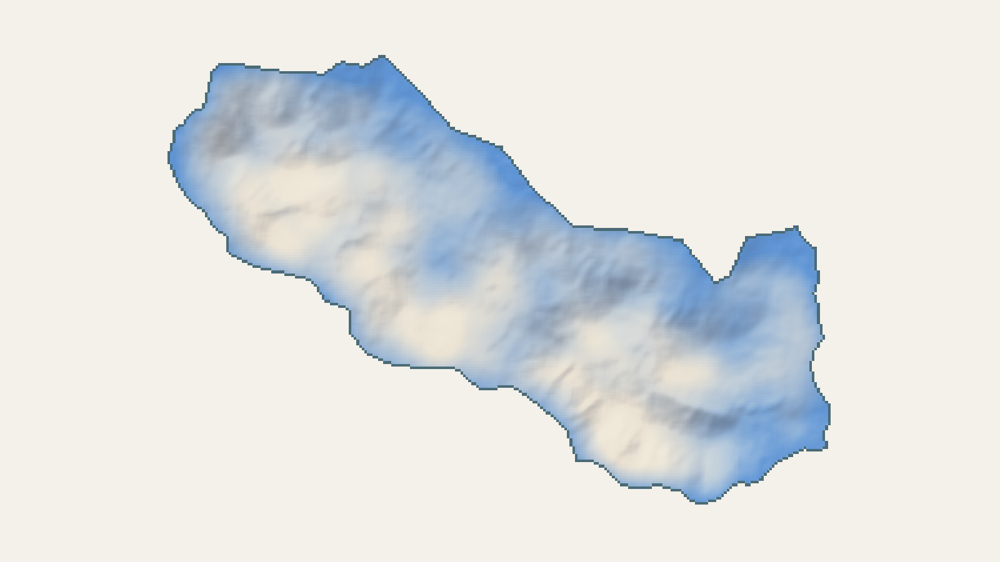
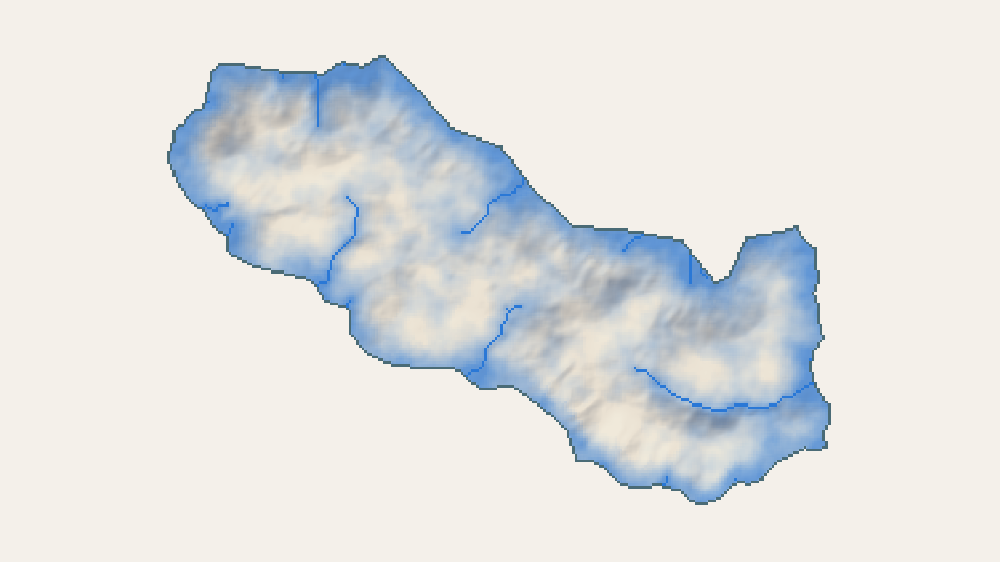
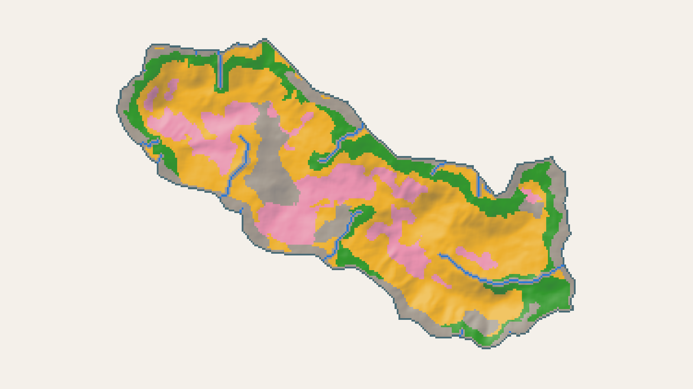
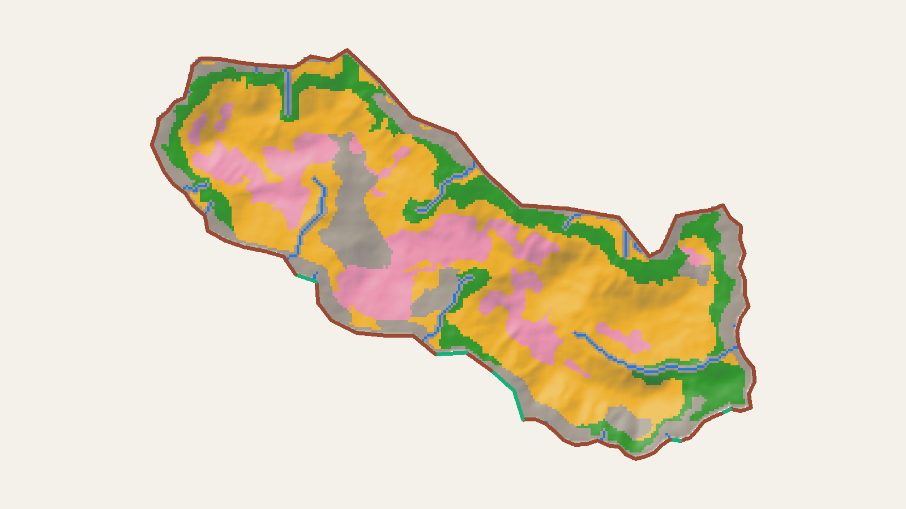
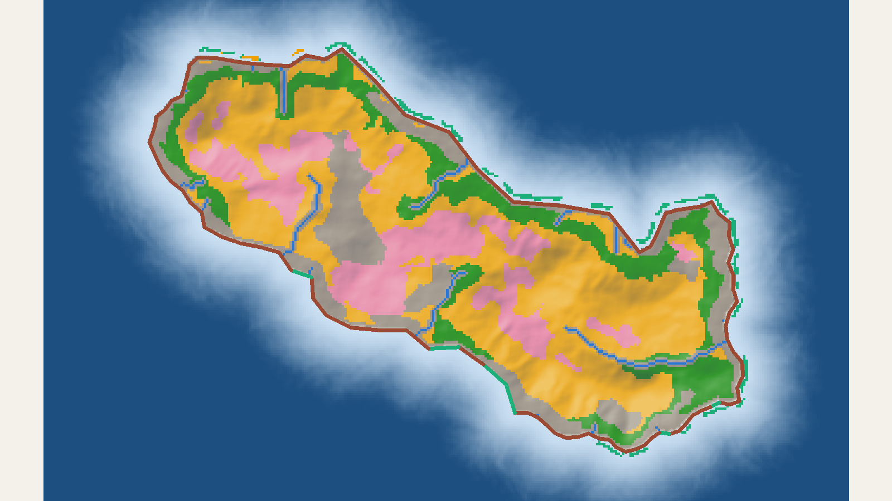
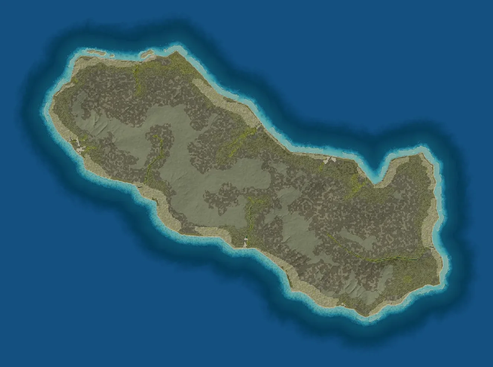

So we recently started a pirate-themed campaign with our Pathfinder 2e group and I used that as an excuse to go down the rabbit hole of procedural generation. This is the collection of my thoughts and finding while investigating a topic that has been in the back of my mind for some time. Procedural generation as a concept is just so cool?!

## The setup

I wanted things to stay close to the original Pathfinder world setting. Luckily for me there is an amazing fan project, where the whole continent is mapped out in great detail: [the PathfinderWiki interactive map](https://map.pathfinderwiki.com/). Based on their map data, I could get a rough outline of the islands, that I would use as a basis for all the procedural work. This roughly looks like this:

<figure>
  <iframe src="https://map.pathfinderwiki.com/#location=11.22/19.507/-26.674"
          title="PathfinderWiki interactive map, centred on the island group"
          loading="lazy" allowfullscreen></iframe>
  <figcaption>The stretch of coast the campaign sails &mdash; <a href="https://map.pathfinderwiki.com/#location=11.22/20.0406/-26.8994">open the map full size</a>.</figcaption>
</figure>

## Procedural Madness

Now comes the fun part ...

### From Polygon to Island

While looking around I found the amazing blog of Amit Patel, who went into quite some detail on his island generation journey. I highly recommend reading through some of the post he has written, such as [Polygon Map Generation for Games](http://www-cs-students.stanford.edu/~amitp/game-programming/polygon-map-generation/).  

After some experimentation I ended up with the following approach:  
Based on the polygon that we extracted from the wiki, we increase the resolution by recursively halving the sides and offsetting the center. We do this three times and end our simplistic 13 point polygon becomes a more realistic 104 point island outline. Do not worry. We will later on improve this further with the power of *erosion*.

<figure>
  <video autoplay loop muted playsinline controls preload="auto" width="2560" height="1440">
    <source src="/assets/video/noisy-edges.mp4" type="video/mp4">
    Your browser will not play this inline &mdash; <a href="/assets/video/noisy-edges.mp4">download the clip</a> instead.
  </video>
  <figcaption>Three rounds of subdivision: every side halved and the new point nudged off the line, taking the outline from 13 points to 104.</figcaption>
</figure>

### Giving it some Filling ...

Now that we have a better outline, lets focus on the island itself. There are different techniques that are being used here. For once we work with Perlin noise, which is a very popular approach for these kinds of generations, because it is smooth and produces nature inspired patterns. It is used a lot in different procedural generation works and produces good visuals. Once you know, you know. And you will see it everywhere.

Where the previous work was concerned with pointlists, the island is now also a raster of evenly sized cells, and every cell carries a height, later also moisture, soil, coast-distance and so on. Building that height happens in three steps. First a rough base: a ramp that climbs about 8 m over the first 0.8 nm inland so the shore is not a wall, a few metres of fine noise on top, and broad hills whose size grows with the island. small islands get no hills, large islands get some. Based on preference and what I thought looked good.

Then comes the step that does the real work. The whole field gets sorted and rebuilt. Every land cell is ranked by height, and the heights are then reassigned along a curve built from two numbers in the profile: how high the island should be, and how much of it should be lowland. So the noise never actually decides the final altitude. All it decides is which cell is higher than which one. The profile decides how high and how flat. Another nice trick from Amit Patel, that allows steering of noise-based generation through simple to understand parameters.

<figure>
  <video autoplay loop muted playsinline controls preload="auto" width="2560" height="1440">
    <source src="/assets/video/relief.mp4" type="video/mp4">
    Your browser will not play this inline &mdash; <a href="/assets/video/relief.mp4">download the clip</a> instead.
  </video>
  <figcaption>pw-241_-154 before and after the redistribution. The order the noise picked stays exactly as it was, only the curve it sits on is replaced by the one relief and lowland describe. 17 m of lumps become the island's full 42 m.</figcaption>
</figure>

Only after that do the stamps land. A volcano gets its cone with lava ribs and a summit crater, an atoll it ring, limestone a karst plateau with sinkholes, and one can place single hills, ridges, basins and sinkholes by hand or randomly on top of that.

### ... And eroding it away again!

While we can get quite a bit of detail from noise, it does not hold up to close inspection and just does not look realistic anymore if you really pay attention. So instead we further develop the mointains with water: erosion. 

In a loop we fill all nooks and crannies with water, which we then drain towards the best fitting neighbor cell. The more water there is, the more land gets moved along, the deeper the water cuts. This is called the stream power law, and there is quite a bit of research on it again. We also add a bit of smoothing and some guards so things do not escalate too fast.

<figure class="wide">
  <video autoplay loop muted playsinline controls preload="auto" width="2560" height="1080">
    <source src="/assets/video/erosion-compare.mp4" type="video/mp4">
    Your browser will not play this inline &mdash; <a href="/assets/video/erosion-compare.mp4">download the clip</a> instead.
  </video>
  <figcaption>Water. Water always finds a way. Left a small flat island, right a partial volcano.</figcaption>
</figure>

Noise is used again to help build the actual gradient the water takes into the next cell, but is only used for the initialization so things look more realistic.

How hard a cell erodes depends mostly on how wet it is. The windward side already catches the rain, so it also cuts the deepest, which is why the wet side of a volcano is the one with the dramatic gorges. Crater rims are deliberately stubborn and wear at half rate, because a caldera that slumps on the first pass is not a caldera any more. Right at the end, one more pass lets anything steeper than the angle of repose slide downhill: 15 degrees if the island is sand, 30 for ordinary soil, 60 for rock and crater walls. Later, when each block is refined, this runs per cell with the actual material. At this scale one angle per island is plenty.

Both islands in the clip are real ones from the campaign. On the left pw-241_-154, nine nautical miles long and barely forty metres at its highest point, where eighty passes took an average of 1.6 m off the land. That sounds like nothing, and on something this flat it nearly is, but it is the difference between a smooth lump and a surface with a grain to it. On the right the Echsenkessel, 1406 m up to the crater rim, where the same eighty passes carry away 42.7 m and cut the gullies running down the outer flanks. Same loop, same code. The only thing that differs is the profile.

### Water and Wind

For now we just note from where the wind comes. There is a permanent storm just north of these islands, so we always have a rather stable wind direction. Then we later can check where rain would catch on and inform hydrology in the next step. Similar with waves, which inform beaches, reefs and coasts. The rain part is bookkeeping: cells are walked in wind order, and the air loses a bit of its water every nautical mile and a bit more for every metre it has to climb. The waves are a separate sweep that measures, for sixteen directions, how much open water lies upwind of each bit of coast.

<figure>
  
  <figcaption>Height first, with rain over it. drier <i class="ramp"></i> wetter It rains on all of it, and harder on the north-east shoulder the trade wind reaches first: 0.82 there against 0.71 in the lee.</figcaption>
</figure>

### Hydrology

Another amazing concept. We flood all holes again, and form lakes, where there are valleys. Then we paint in rivers based on the erosion we calculated earlier and get an idea of where freshwater is available for flora and fauna later on. These can inform moisture classes for different vegetation later.

<figure>
  
  <figcaption>Then it settles. What the plants read is moisture: the rain, plus whatever the ground keeps (the lens under the low coast, a band either side of every stream), minus what a scrub island is owed. Each map is stretched over its own range, so this one is not as wet as it looks. Where the rain map read 0.71 in the lee, the moisture here is 0.55, which is exactly the dry line. The streams are the threads.</figcaption>
</figure>

### Sow the Seed

Because we want different islands, we set up some different plant "families" with different requirements. Coconut groves, mangroves, river plants. Those are fixed by the cells they need. We also have other features of the cells, such as how dry or wet they are, how high they are, how close they are to rivers and fresh water, and so on. We also make sure that birds of a feather flock together, and have a starkly increased likelihood for similar plants to grow together. Thus transitions happen smoothly after e.g. a dry patch.

<figure>
  
  <figcaption>Plant families on top. <i style="background:#eda100"></i>dry forest <i style="background:#e87ba4"></i>thorn scrub <i style="background:#008300"></i>moist forest <i style="background:#8a8178"></i>everything else</figcaption>
</figure>

### Back to the shore

We can refine the shoreline based on the cell data we gathered. Is there a lot of plants holding things together, do we have a lot of wind and water? Cliffs and boulders if there is hard exposure. If there is only gentle breeze and we are facing the wind, its a beach. If it is sheltered from wind, we could have mangrooves. Maybe I will add some temperature later on here, with a fantasy-inspired undertone of course. Beach is the default: a stretch only becomes something else if it is steep enough and exposed enough to earn it.

<figure>
  
  <figcaption>Then the coast gets typed. <i style="background:#9d4a35"></i>beach <i style="background:#1baf7a"></i>mangrove No cliffs on this island.</figcaption>
</figure>

### And out into the ocean

Because the area around the island looks pretty bleak now, we create some more detail. Once the coast is finalized, we can have shelf fields, reef bands, lagoons and so on, all based on wind direction and protection from the elements. We decide whats fitting and then build details based on perlin noise again. Which reef an island gets follows Darwin's old sequence, fringing to barrier to atoll, so the reef says something about how old the island is meant to be.

<figure>
  
  <figcaption>We have some noice-based fringing, impacted by the wave-directions again, and then some Detailing with   <i style="background:#1baf7a"></i>reef and <i style="background:#eda100"></i>cay</figcaption>
</figure>

### And then again, at two metres

Everything up to here happens on a coarse grid, somewhere between twenty and seventy metres per cell depending on how big the island is. That is plenty for deciding where things go and nowhere near enough to look at. So the whole thing runs again, closer.

The island gets cut into blocks of 2048 m with a 128 m overlap. That is the trick that keeps the memory cost flat: a block at two metres is about a thousand cells square no matter how large the island is, so a big island just means more blocks rather than a bigger problem. Each block takes the coarse raster, interpolates it up, and then earns its detail the same way as before, by eroding rather than by adding noise. Thermal and stream power again, first at eight metres and then at two, with the rivers of the coarse network cutting through so a stream stays in the same place at every scale.

Then the plants stop being classes and turn into things. A hashed grid of candidate positions gets filtered through the society rules, and anything above a metre and a half becomes an actual model. Everything shorter stays a density value that the ground shader paints. None of it ever touches the disk.

Last comes the light. A ray marched towards the sun for the cast shadows, a sweep of the horizon for how much sky each spot can see, then an orthographic camera pointed straight down, one image per block at half a metre per pixel. Those get cut into a tile pyramid and packed into a single file per island that the map reads directly.

The part I like best: every bit of noise is hashed from world coordinates and the island seed, so two blocks that overlap compute exactly the same values in the overlap. There are no seams to hide, and any block can be rebuilt on its own without touching the rest.

<figure>
  
  <figcaption>And out the other end. Same island, same outline as every picture above. The sand rim is the beach the shore step typed, the canopy is the plant families from further up, the turquoise is the reef, and the green threads running down to the coast are the streams.</figcaption>
</figure>
